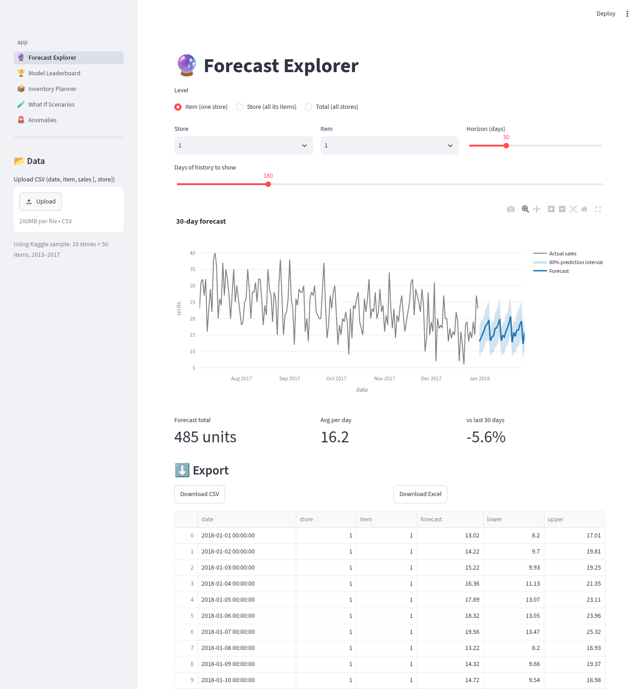
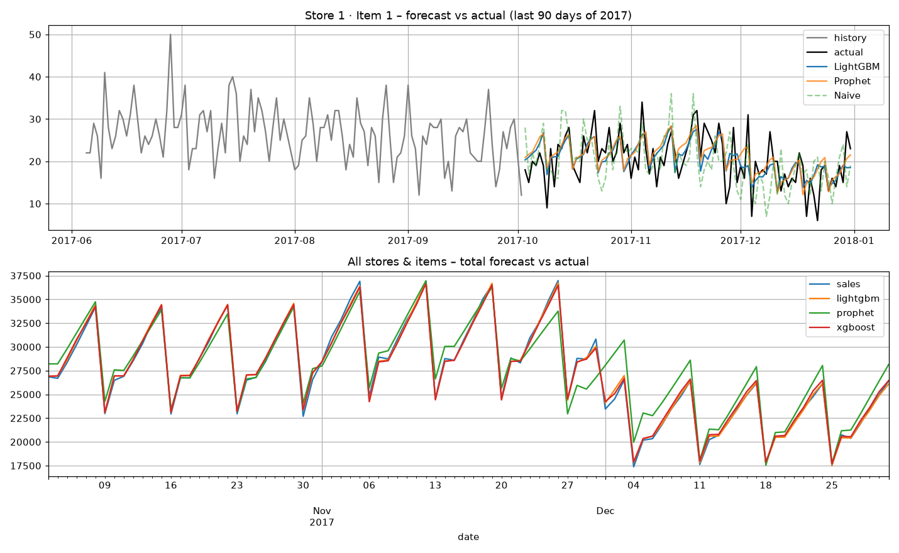
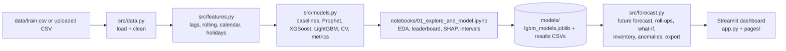

# 📈 AI Sales Forecaster

An end-to-end machine-learning project that predicts daily sales for **500 store–item
combinations** (10 stores × 50 items) up to 90 days ahead, compares five forecasting
models, explains its predictions, and turns forecasts into **restocking decisions**
through a multi-page web dashboard.

Built by **Kinza Amjad** as a learning project: every file is commented in plain English.

## 🇵🇰 Why it matters
Most small retailers in Lahore and across Pakistan (kiryana stores, bakeries, clothing shops) restock by gut feeling.
Demand swings hard around **Ramadan, Eid ul-Fitr, Eid ul-Adha** and public holidays, so shops either run out during the
rush or get stuck with unsold stock afterwards. This project turns past daily sales into a forecast and a concrete
"how much to order and when" plan, with a Pakistani holiday calendar built in.

> **Honest note:** it is currently trained on a **public sample dataset** (Kaggle store-item sales, not Pakistani).
> It has **not yet been used with a real shop's data**. The app accepts your own CSV, and that's the next step.



## ✨ Features
- **5-model leaderboard**: naive (last year), 28-day moving average, Prophet, XGBoost, LightGBM
- **Time-series cross-validation**: 3 expanding-window folds × 90 days
- **Leak-free feature engineering**: lags, rolling stats, calendar and holiday features (all ≥ 91 days old)
- **Prediction intervals**: 80% band from quantile LightGBM (coverage checked on test data)
- **SHAP explanations**: which features drive the model
- **Anomaly detection** on past sales (robust z-score / MAD)
- **Hierarchical roll-ups**: item → store → total
- **What-if scenarios**: promotion uplift, price change with elasticity, revenue impact
- **Inventory planner**: safety stock, reorder point, service level, order quantity, projected stock chart
- **CSV + Excel export** of forecasts and plans
- **Upload your own CSV** (`date, item, sales[, store]`) and the app retrains on it

## 📊 Data
**Real data:** Kaggle [Store Item Demand Forecasting Challenge](https://www.kaggle.com/competitions/demand-forecasting-kernels-only/data)
`train.csv` (913,000 rows, 2013-01-01 → 2017-12-31, columns `date, store, item, sales`).
Kaggle needs a login, so the identical file was downloaded from a public GitHub mirror
([DharitShah13/Kaggle-Store-Item-Demand-Forecasting-Challenge](https://github.com/DharitShah13/Kaggle-Store-Item-Demand-Forecasting-Challenge)).
No synthetic data is used.

### 🇵🇰 Holiday calendar: Pakistan by default
`COUNTRY = "PK"` at the top of `src/features.py` sets the calendar. In Pakistan mode the model gets:
- **Public holidays** (Pakistan Day, Independence Day, Eids, Ashura, etc.) from the `holidays` library, plus a "day before a holiday" flag
- **Ramadan**: `is_ramadan` and `ramadan_day` (1–30)
- **Eid ul-Fitr and Eid ul-Adha**: `is_eid_fitr`/`is_eid_adha`, plus `days_to_eid_*` (1–7 days before: the shopping rush) and `days_after_eid_*` (1–7 days after)

Eid dates come from Pakistan's calendar in `holidays`; Ramadan start dates come from `hijridate` (Islamic calendar),
lined up so Ramadan always ends the day before Pakistan's Eid. Dates are available for 2013–2030 and beyond, so future
forecasts work. They're fixed calendar facts, so they don't leak the future. Future years are estimates, because the
real dates depend on moon sighting (±1 day).
Prophet gets the same calendar (Ramadan as a month-long event, plus a 7-day pre-Eid rush).

To go back to US holidays, set `COUNTRY = "US"` and re-run the notebook so the saved models match.

> ⚠️ **The Kaggle data isn't Pakistani** (it has no Ramadan or Eid patterns), so these features barely change the
> results below. They'll start to matter once you upload **real sales from a Lahore shop**.

## 🏆 Results (real numbers from the saved run)
Numbers below come from a fresh run of the notebook on Python 3.12 with the pinned `requirements.txt` (train time measured on a Linux box; yours will differ).
**Hold-out test = last 90 days (2017-10-03 → 2017-12-31), all 500 series** (lower is better):

| Model | MAE | MAPE % | SMAPE % | Train+predict (s) |
|---|---|---|---|---|
| LightGBM | 5.90 | 12.91 | 12.42 | 8.8 |
| XGBoost | 5.91 | 13.02 | 12.41 | 9.9 |
| Prophet | 6.36 | 14.16 | 13.23 | 24.5 |
| Naive (last year) | 8.35 | 17.69 | 17.87 | 0.0 |
| Moving avg (28d) | 11.75 | 26.94 | 22.25 | 0.4 |

LightGBM's MAE is **29.4% lower** than the naive "same day last year" baseline.

**Time-series cross-validation** (3 folds: Apr–Jul, Jul–Oct, Oct–Dec 2017; Prophet left out because 1,500 fits is slow):

| Model | MAE (mean ± std) | MAPE % (mean ± std) | SMAPE % (mean ± std) |
|---|---|---|---|
| LightGBM | 6.29 ± 0.34 | 11.95 ± 0.85 | 11.50 ± 0.80 |
| XGBoost | 6.34 ± 0.38 | 12.04 ± 0.87 | 11.54 ± 0.76 |
| Naive (last year) | 8.88 ± 0.47 | 16.27 ± 1.23 | 16.48 ± 1.20 |
| Moving avg (28d) | 12.38 ± 1.70 | 22.20 ± 4.12 | 20.82 ± 3.03 |

**80% prediction-interval coverage on the test set** (ideal = 80%): LightGBM quantile **78.9%**, Prophet **76.0%**.

**Top SHAP features:** `lag_364` (same day last year), `roll_mean_364`, `lag_371`, `month`, `dayofweek`.
Holiday, Ramadan and Eid flags matter very little in this (non-Pakistani) dataset; `ramadan_day` is the strongest of them.




## 🏗️ Architecture

```
CSV ──► data.py ──► features.py ──► models.py ──► notebook ──► models/*.joblib
                                                                     │
          Streamlit app (app.py + pages/) ◄── forecast.py ◄──────────┘
```

## 🚀 Run it locally

### Mac setup (first time)
```bash
# 1. Install Python 3.12 from https://www.python.org/downloads/ (then use `python3.12`)
# 2. Install Homebrew (https://brew.sh), then the OpenMP library LightGBM/XGBoost need:
brew install libomp
```

### Install and run
```bash
git clone https://github.com/kinzaamjad35-dev/sales-forecaster.git && cd sales-forecaster
python3.12 -m venv .venv && source .venv/bin/activate     # Windows: .venv\Scripts\activate
pip install -r requirements.txt          # add -r requirements-dev.txt for the notebook/Jupyter
jupyter notebook notebooks/01_explore_and_model.ipynb  # optional: re-run training (~3 min)
streamlit run app.py                                   # opens http://localhost:8501
python tools/test_app.py                               # headless test of every page
```
The trained model is included in `models/`, so the app works without re-running the notebook.

## 🌐 Deploy free on Streamlit Community Cloud
1. Push this repo to GitHub (public).
2. Go to [share.streamlit.io](https://share.streamlit.io) → **New app** → pick the repo, branch `main`, main file `app.py`.
3. Under *Advanced settings* choose Python **3.12**. `requirements.txt` and `packages.txt` (installs `libgomp1` for LightGBM) are picked up automatically.
The sample data (17 MB) and trained model (11 MB) are included, so no extra setup is needed.

## ☁️ Run in Google Colab
1. Upload this folder to Google Drive (or push it to GitHub).
2. New Colab notebook, then:
```python
from google.colab import drive; drive.mount('/content/drive')
%cd /content/drive/MyDrive/sales-forecaster      # or: !git clone <your-repo-url> && %cd sales-forecaster
!pip install -q -r requirements.txt
```
3. Open `notebooks/01_explore_and_model.ipynb` in Colab and Run all.
4. To try the dashboard from Colab: `!streamlit run app.py & npx localtunnel --port 8501`
   (or just run the app locally, which is easier).

## 📁 Project structure
```
sales-forecaster/
├── app.py                         # dashboard home: overview KPIs
├── pages/
│   ├── 1_🔮_Forecast_Explorer.py  # forecast by store/item, roll-ups, export
│   ├── 2_🏆_Model_Leaderboard.py  # model comparison, CV, SHAP
│   ├── 3_📦_Inventory_Planner.py  # safety stock, reorder point, order qty
│   ├── 4_🧪_What_If_Scenarios.py  # promotion / price scenarios
│   └── 5_🚨_Anomalies.py          # unusual sales days
├── src/
│   ├── data.py        # loading + cleaning
│   ├── features.py    # feature engineering
│   ├── models.py      # models, metrics, cross-validation
│   ├── forecast.py    # forecasting + business tools
│   └── app_utils.py   # shared Streamlit helpers (caching, pickers)
├── notebooks/01_explore_and_model.ipynb   # executed, outputs saved
├── data/train.csv                         # Kaggle dataset
├── models/            # trained LightGBM models + result tables
├── images/            # charts + app screenshots
├── tools/             # notebook builder + app test script
├── requirements.txt       # pinned app dependencies
├── requirements-dev.txt   # + Jupyter for the notebook
├── packages.txt           # system package for Streamlit Cloud (libgomp1)
├── LICENSE                # MIT
└── README.md
```

## 🔧 Ideas to extend it
- Use **real data from a local shop** in Lahore, where the Ramadan and Eid features should really pay off
- **Tune hyper-parameters** with Optuna and log experiments with MLflow
- Add **price and promotion columns** so the what-if tool is learned from data instead of rules
- Try **deep learning** models (N-BEATS, Temporal Fusion Transformer via `darts` or `neuralforecast`)
- **Reconcile** the hierarchy properly (MinT) instead of simple bottom-up sums
- Add an **email/WhatsApp alert** when an item drops below its reorder point

## ⚠️ Limitations (honest notes)
- The dataset is clean and very regular (it's a competition dataset), so real shop data will be noisier.
- What-if scenarios use a fixed price elasticity you choose; the model has never seen prices or promotions.
- Store/total intervals are sums of item intervals, which makes them wider than they really are.

## 📄 License
MIT © 2026 Kinza Amjad, see [LICENSE](LICENSE). Dataset: Kaggle Store Item Demand Forecasting Challenge (subject to its own terms).
