<p align="center">
  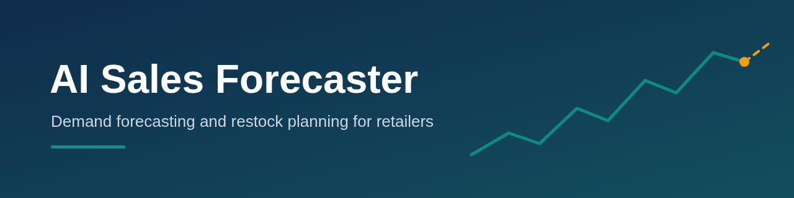
</p>

<p align="center">
  
  
  
  <a href="LICENSE"></a>
</p>

<p align="center">
  <b>Live demo:</b> <a href="https://sales-forecaster-nesmftfrujdtyu8kwyba9h.streamlit.app">sales-forecaster-nesmftfrujdtyu8kwyba9h.streamlit.app</a>
</p>

<table align="center">
  <tr>
    <td align="center"><h2>29%</h2>lower error than the<br>"same day last year" baseline</td>
    <td align="center"><h2>90 days</h2>forecast horizon with<br>80% prediction intervals</td>
    <td align="center"><h2>6 pages</h2>interactive dashboard,<br>500 store-item series</td>
  </tr>
</table>

---

An end-to-end machine-learning project that predicts daily sales for **500 store-item
combinations** (10 stores x 50 items) up to 90 days ahead, compares five forecasting
models, explains its predictions, and turns forecasts into **restocking decisions**
through a multi-page web dashboard. Built by **Kinza Amjad**.

<p align="center">
  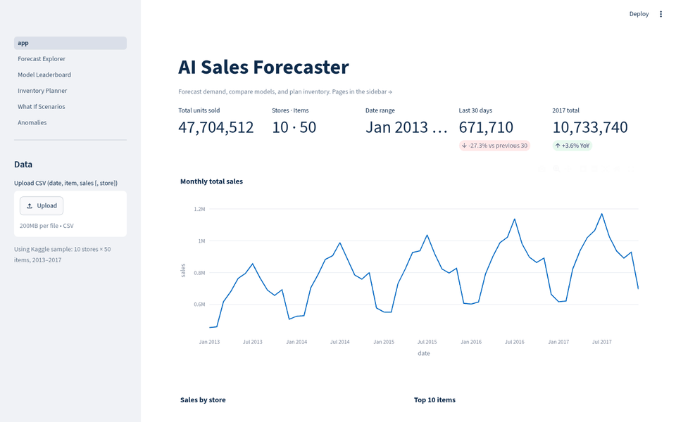
</p>

## Why it matters
Small and medium-sized retailers often make inventory decisions on intuition rather than data. Demand varies with the day of the week, the season and long-term trends, which leads to stock shortages at peak times and excess inventory during quieter periods. This project turns historical daily sales into accurate demand forecasts and a clear restocking plan that shows how much to order and when.

> **Honest note:** it is currently trained on a **public sample dataset** (Kaggle store-item sales).
> It has **not yet been used with a real shop's data**. The app accepts your own CSV, and that is the next step.

## Features
- **5-model leaderboard**: naive (last year), 28-day moving average, Prophet, XGBoost, LightGBM
- **Time-series cross-validation**: 3 expanding-window folds x 90 days
- **Leak-free feature engineering**: lags, rolling stats, calendar features (all at least 91 days old)
- **Prediction intervals**: 80% band from quantile LightGBM (coverage checked on test data)
- **SHAP explanations**: which features drive the model
- **Anomaly detection** on past sales (robust z-score / MAD)
- **Hierarchical roll-ups**: item, store, total
- **What-if scenarios**: promotion uplift, price change with elasticity, revenue impact
- **Inventory planner**: safety stock, reorder point, service level, order quantity, projected stock chart
- **CSV and Excel export** of forecasts and plans
- **Upload your own CSV** (`date, item, sales[, store]`) and the app retrains on it

## Screenshots
<table>
  <tr>
    <td><p align="center">Overview</p></td>
    <td>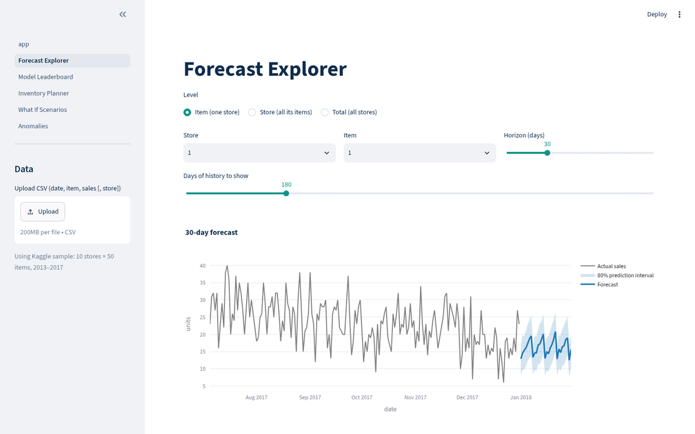<p align="center">Forecast Explorer</p></td>
  </tr>
  <tr>
    <td>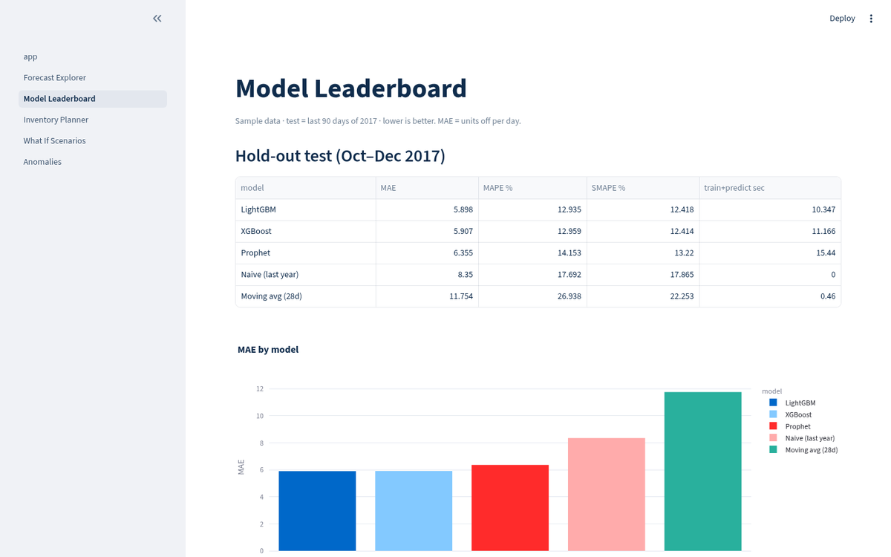<p align="center">Model Leaderboard</p></td>
    <td>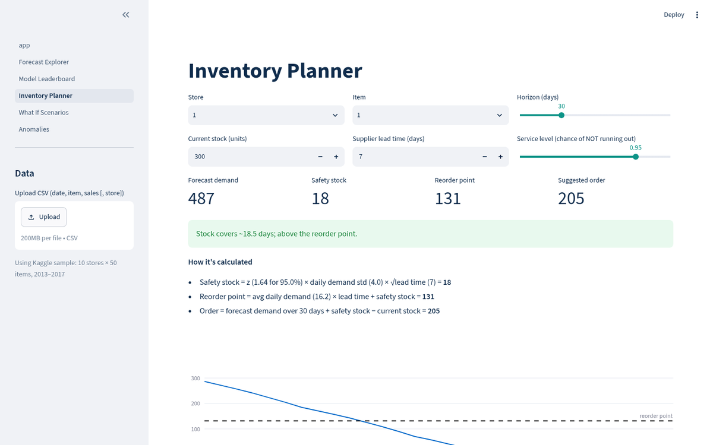<p align="center">Inventory Planner</p></td>
  </tr>
  <tr>
    <td>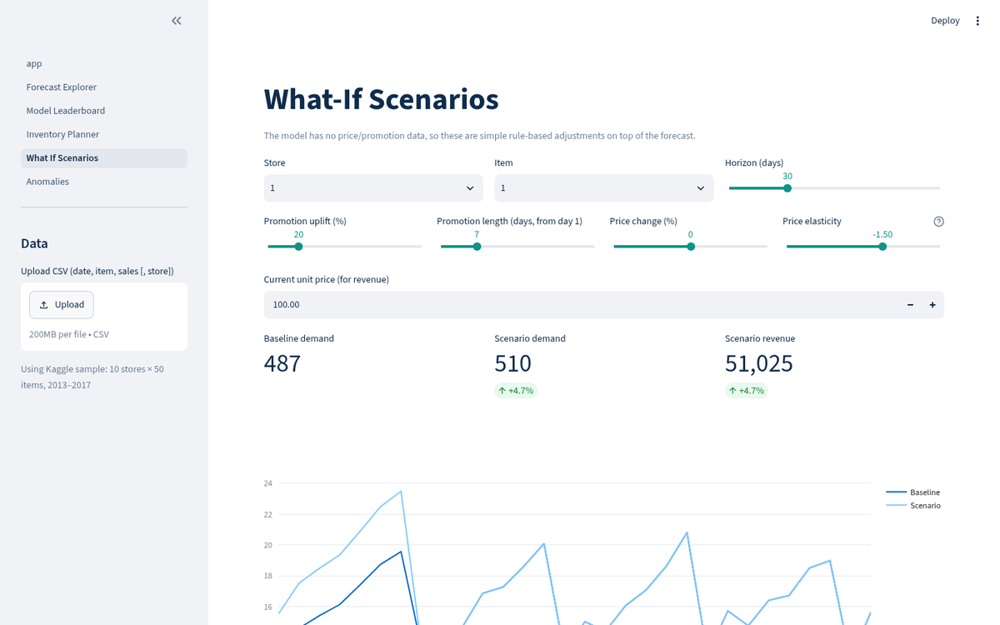<p align="center">What-If Scenarios</p></td>
    <td>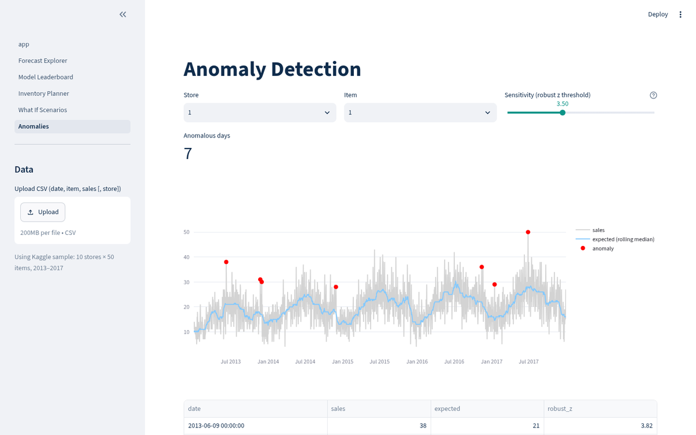<p align="center">Anomaly Detection</p></td>
  </tr>
</table>

## How it works
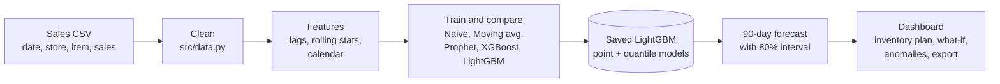

## Results
All numbers come from an actual run of the notebook on Python 3.12 with the pinned `requirements.txt`.
**Hold-out test:** last 90 days (2017-10-03 to 2017-12-31), all 500 series, lower is better.

<p align="center">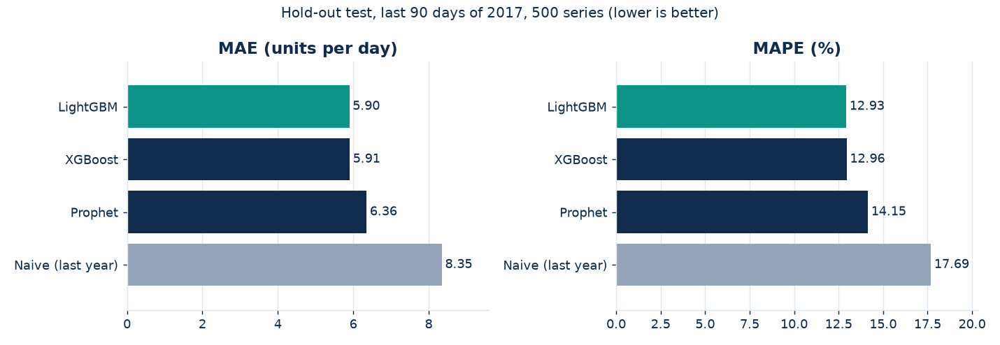</p>

| Model | MAE | MAPE % | SMAPE % | Train+predict (s) |
|---|---|---|---|---|
| **LightGBM** | **5.90** | **12.93** | 12.42 | 10.3 |
| XGBoost | 5.91 | 12.96 | 12.41 | 11.2 |
| Prophet | 6.36 | 14.15 | 13.22 | 15.4 |
| Naive (last year) | 8.35 | 17.69 | 17.87 | 0.0 |
| Moving avg (28d) | 11.75 | 26.94 | 22.25 | 0.4 |

LightGBM's MAE is **29.4% lower** than the naive "same day last year" baseline.

### Forecast vs actual
<p align="center">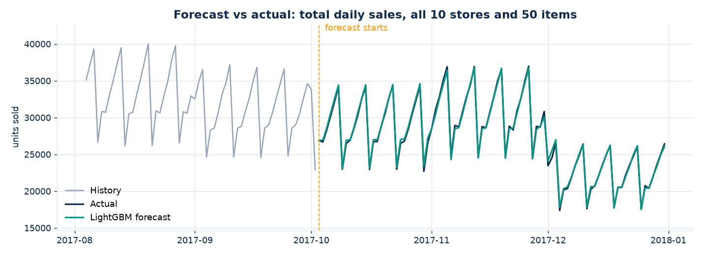</p>

### Before and after
Copying last year's sales versus the LightGBM forecast, on a single series (store 1, item 1):

<p align="center">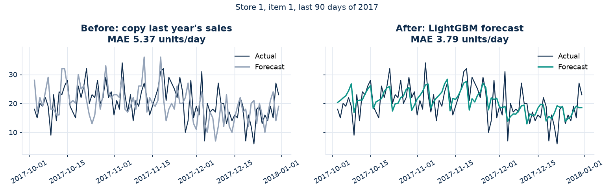</p>

<details>
<summary><b>More results: cross-validation, intervals, SHAP</b></summary>

**Time-series cross-validation** (3 folds: Apr-Jul, Jul-Oct, Oct-Dec 2017; Prophet left out because 1,500 fits is slow):

| Model | MAE (mean ± std) | MAPE % (mean ± std) | SMAPE % (mean ± std) |
|---|---|---|---|
| LightGBM | 6.30 ± 0.35 | 11.94 ± 0.87 | 11.50 ± 0.80 |
| XGBoost | 6.34 ± 0.38 | 12.02 ± 0.85 | 11.55 ± 0.76 |
| Naive (last year) | 8.88 ± 0.47 | 16.27 ± 1.23 | 16.48 ± 1.20 |
| Moving avg (28d) | 12.38 ± 1.70 | 22.20 ± 4.12 | 20.82 ± 3.03 |

**80% prediction-interval coverage on the test set** (ideal = 80%): LightGBM quantile **79.3%**, Prophet **76.7%**.

**Top SHAP features:** `lag_364` (same day last year), `roll_mean_364`, `lag_371`, `month`, `dayofweek`.

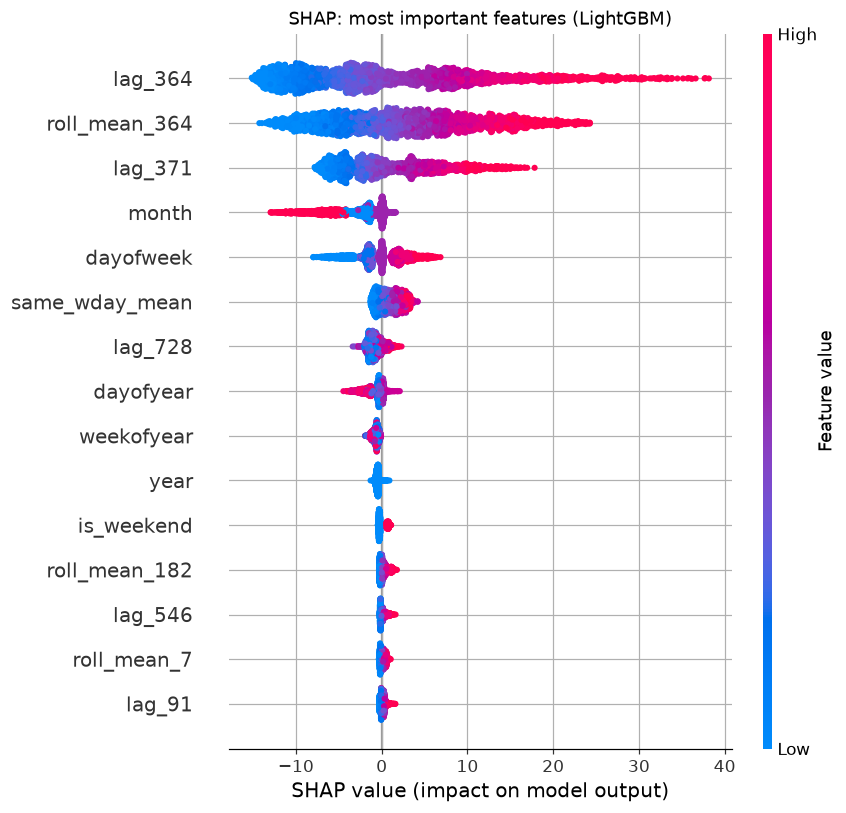
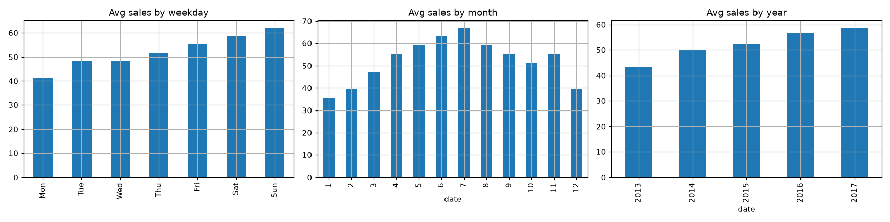

</details>

## Data
Kaggle [Store Item Demand Forecasting Challenge](https://www.kaggle.com/competitions/demand-forecasting-kernels-only/data):
`train.csv`, 913,000 rows, 2013-01-01 to 2017-12-31, columns `date, store, item, sales`.
Kaggle needs a login, so the identical file was downloaded from a public GitHub mirror
([DharitShah13/Kaggle-Store-Item-Demand-Forecasting-Challenge](https://github.com/DharitShah13/Kaggle-Store-Item-Demand-Forecasting-Challenge)).
No synthetic data is used.

## Getting started

```bash
git clone https://github.com/kinzaamjad35-dev/sales-forecaster.git && cd sales-forecaster
python3.12 -m venv .venv && source .venv/bin/activate
pip install -r requirements.txt
streamlit run app.py          # opens http://localhost:8501
```
The trained model is included in `models/`, so the app works without retraining.

<details>
<summary><b>Mac setup (first time)</b></summary>

1. Install Python 3.12 from [python.org](https://www.python.org/downloads/), then use `python3.12` in Terminal.
2. Install [Homebrew](https://brew.sh), then the OpenMP library that LightGBM and XGBoost need:
   ```bash
   brew install libomp
   ```
</details>

<details>
<summary><b>Retrain, test and rebuild the charts</b></summary>

```bash
pip install -r requirements-dev.txt
jupyter notebook notebooks/01_explore_and_model.ipynb   # re-run training (about 3 min)
python tools/test_app.py                                # headless test of every page
python tools/make_readme_assets.py                      # rebuild the charts in docs/
```
On Windows, activate the environment with `.venv\Scripts\activate`.
</details>

<details>
<summary><b>Deploy on Streamlit Community Cloud</b></summary>

1. Push this repo to GitHub (public).
2. Go to [share.streamlit.io](https://share.streamlit.io), click **New app**, pick the repo, branch `main`, main file `app.py`.
3. Under *Advanced settings* choose Python **3.12**. `requirements.txt` and `packages.txt` (installs `libgomp1` for LightGBM) are picked up automatically.

The sample data (17 MB) and trained model (11 MB) are included, so no extra setup is needed.
</details>

<details>
<summary><b>Run in Google Colab</b></summary>

```python
!git clone https://github.com/kinzaamjad35-dev/sales-forecaster.git
%cd sales-forecaster
!pip install -q -r requirements.txt
```
Then open `notebooks/01_explore_and_model.ipynb` and run all cells.
</details>

<details>
<summary><b>Project structure</b></summary>

```
sales-forecaster/
├── app.py                       # dashboard home: overview KPIs
├── pages/
│   ├── 1_Forecast_Explorer.py   # forecast by store/item, roll-ups, export
│   ├── 2_Model_Leaderboard.py   # model comparison, CV, SHAP
│   ├── 3_Inventory_Planner.py   # safety stock, reorder point, order qty
│   ├── 4_What_If_Scenarios.py   # promotion / price scenarios
│   └── 5_Anomalies.py           # unusual sales days
├── src/
│   ├── data.py                  # loading + cleaning
│   ├── features.py              # feature engineering (lags, rolling stats, calendar)
│   ├── models.py                # models, metrics, cross-validation
│   ├── forecast.py              # forecasting + business tools
│   └── app_utils.py             # shared Streamlit helpers
├── notebooks/01_explore_and_model.ipynb
├── data/train.csv               # Kaggle dataset
├── models/                      # trained LightGBM models + result tables
├── docs/                        # README banner, charts, screenshots, demo GIF
├── images/                      # charts written by the notebook
├── tools/                       # notebook builder, app test, README chart builder
├── .streamlit/config.toml       # dashboard theme
├── requirements.txt             # pinned app dependencies
├── requirements-dev.txt         # + Jupyter for the notebook
├── packages.txt                 # system package for Streamlit Cloud (libgomp1)
└── LICENSE
```
</details>

## License
MIT © 2026 Kinza Amjad, see [LICENSE](LICENSE). Dataset: Kaggle Store Item Demand Forecasting Challenge (subject to its own terms).
